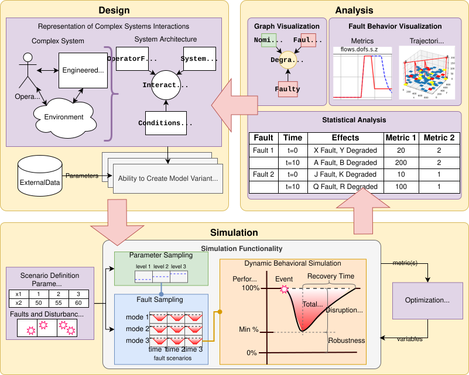
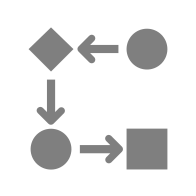

[](https://github.com/nasa/fmdtools)

# Overview


[](https://pypi.org/project/fmdtools/)
[](https://pepy.tech/project/fmdtools)
[](https://pepy.tech/project/fmdtools)
[](https://github.com/nasa/fmdtools/releases)
[](https://github.com/nasa/fmdtools/tags)
[](https://www.codefactor.io/repository/github/nasa/fmdtools)
[](https://htmlpreview.github.io/?https://github.com/nasa/fmdtools/blob/main/tests/reports/full-py314/junit/report.html)
[](https://htmlpreview.github.io/?https://github.com/nasa/fmdtools/blob/main/tests/reports/full-py314/coverage_html/index.html)
[](https://github.com/nasa/fmdtools/blob/main/LICENSE)
[](https://nodis3.gsfc.nasa.gov/displayDir.cfm?Internal_ID=N_PR_7150_002D_&page_name=AppendixD)

**fmdtools** (Fault Model Design tools) is a Python library for modelling, simulating and analysing the resilience of complex systems. Define system behaviour, simulate faults and disturbances, and quantify their effects on risk, safety and resilience.

[Documentation](https://fmdtools.readthedocs.io/en/latest/) · [Examples](examples/Examples.rst) · [Installation](#install-fmdtools) · [Contributing](#contributions)

## About



The fmdtools library provides the computational support needed to perform a simulation-based analysis of systems resilience, as shown above. This analysis of resilience can enable the quantification of risk and safety of given hazards in complex systems where there are dynamic interactions between the system, operators, and the environment.

Key features include:


### Flexible, LLM-Ready Modelling Paradigm
Models in fmdtools use a straightforward and composable code-based representation of system structure and behavior. Since fmdtools models are based on open-source Python, models can be readily generated from your LLM of choice with the right prompting. Whether you want to model a simple component, a complex system-of-systems, or both, fmdtools can help.


### Powerful Simulation Techniques
Simulation techniques in fmdtools represent the state-of-the-art in dynamical systems modelling for resilience quantification. With fmdtools, you can simulate the dynamic effects of hazardous scenarios over a wide range of variables to quantify and optimize risk, resilience, and safety metrics. 

 

### Efficient Analysis Process
Readily-deployable analysis methods are built in to fmdtools to enable the rapid and iterative statistical analysis of simulation results. With fmdtools, you can easily leverage our existing methods to understand simulation results instead of spending hours implementing your own.


The fmdtools documentation repository is also home to the Functional Reasoning Design Language specification, a graphical language that may be used to represent the structure of behavioral interactions in a system to inform hazard analysis.

### Demo Portfolio

Browse the [example catalogue](examples/Examples.rst) for simulations, analyses and runnable demonstrations.

**Featured examples**

- **[Planetary-observation satellite](examples/planetary_observation/readme.rst)**: simulate observations, disturbances and faults; inspect the [visual walkthrough](examples/planetary_observation/demo_satellite.ipynb), [risk/FMEA workflow](examples/planetary_observation/risk_analysis.rst) and [image-classification example](examples/planetary_observation/classification.rst).
- **External-model integration**: the satellite classifier demonstrates a scikit-learn model inside a simulation function; a [reusable adapter-pattern example is under review](https://github.com/nasa/fmdtools/pull/343).


</img>
</img>
</img>
</img>
</img>
</img>


## Getting Started

### Python version compatibility

The fmdtools library is developed in Python 3.14 but is tested to maintain compatibility over three versions of Python. See current test reports below:

| Python Version    | Test Report | Coverage |
| -------- | ------- | ------- |
| 3.12 | [](https://htmlpreview.github.io/?https://github.com/nasa/fmdtools/blob/main/tests/reports/fasttests-py312/junit/report.html)   | [](https://htmlpreview.github.io/?https://github.com/nasa/fmdtools/blob/main/tests/reports/fasttests-py312/coverage_html/index.html) |
| 3.13 | [](https://htmlpreview.github.io/?https://github.com/nasa/fmdtools/blob/main/tests/reports/fasttests-py313/junit/report.html)    | [](https://htmlpreview.github.io/?https://github.com/nasa/fmdtools/blob/main/tests/reports/fasttests-py313/coverage_html/index.html) |
| 3.14 | [](https://htmlpreview.github.io/?https://github.com/nasa/fmdtools/blob/main/tests/reports/fasttests-py314/junit/report.html)   | [](https://htmlpreview.github.io/?https://github.com/nasa/fmdtools/blob/main/tests/reports/fasttests-py314/coverage_html/index.html) |

Further tests of our examples are performed in the Python 3.14. Thus, it is generally recommended to use Python 3.14 with this version to keep pace with development, especially when running examples.

### Set up a Python environment

fmdtools supports Python **3.12, 3.13 and 3.14**, with Python 3.14 recommended for running the latest examples. Use a dedicated environment with [uv](https://docs.astral.sh/uv/) or another Python environment manager. For editor support, see [VS Code](https://code.visualstudio.com/) or [Spyder](https://www.spyder-ide.org/); install the `spyder-kernels` version requested by Spyder if using a separate interpreter.

Some optional notebooks need Jupyter, and Graphviz visualisations may need the [Graphviz application](https://graphviz.org/download/) in addition to the Python package. On Windows, a compiler may be needed if a dependency has no compatible wheel.

### Install fmdtools

Install the released library from [PyPI](https://pypi.org/project/fmdtools/):

```bash
python -m pip install fmdtools
```

Check the installation:

```python
import fmdtools
print(fmdtools.__version__)
```

#### Editable development install

Clone the [repository](https://github.com/nasa/fmdtools) and install it in editable mode to work on source code and run examples:

```bash
git clone https://github.com/nasa/fmdtools.git
cd fmdtools
python -m pip install -e ".[all]"
```

The `[all]` extra installs the example dependencies. For development and test tooling, follow the [contribution guide](https://fmdtools.readthedocs.io/en/latest/docs-source/Contributions.html) and its dependency-group instructions. To work with a particular release, check out an existing [release tag](https://github.com/nasa/fmdtools/tags) before installing.

#### Dependencies

The authoritative package requirements are in [pyproject.toml](pyproject.toml). Current notable constraints include:

- Python 3.12 or newer, with 3.12–3.14 tested;
- `numpy >= 2.0`, `matplotlib >= 3.7.0` and `shapely >= 2.0`;
- `pandas[plot,output-formatting] >= 2.2.0` and `recordclass == 0.24`.

The direct requirements also include SciPy, tqdm, NetworkX, ordered-set, dill, pytest and graphviz. The `[all]` extra includes example dependencies such as scikit-learn, DEAP and pymoo. Documentation and testing tooling is configured separately in `pyproject.toml`; relevant third-party licences remain those of their respective projects.

### Explore Tutorials and Resources

Once fmdtools is installed, use the following to get acquainted with how to use the library:

- Go through the [Intro to fmdtools workshop](https://fmdtools.readthedocs.io/en/latest/docs-source/Intro_to_fmdtools.html) to learn about some of the basics of the fmdtools library and work with an existing model.

- Explore more [examples](https://fmdtools.readthedocs.io/en/latest/examples/Examples.html) of particular use-cases by going through the [examples folder](https://github.com/nasa/fmdtools/tree/main/examples)

- Read about contributions and model development best practices by perusing the [Development Guide](https://fmdtools.readthedocs.io/en/latest/docs-source/development-guide.html).

- Explore the searchable [module reference](https://fmdtools.readthedocs.io/en/latest/docs-source/fmdtools.html) for syntax and usage documentation.

### Coding Agent/LLM Tips

Decent (but **very imperfect**) results can be achieved using LLMs for model development using the prompt:

```prompt
You are an experienced software engineer learning a new Python library for the first time.
Make an fmdtools simulation of a <enter your system here> using the latest syntax from `https://github.com/nasa/fmdtools/tree/v2.6.0.dev3` for all modeling (`fmdtools.define`), simulation (`fmdtools.sim`), and analysis (`fmdtools.analyze`) classes.
The output should be a bare bones but well-commented .py file with simple behaviors for each class and a small script at the bottom leveraging the built-in capabilities in the `fmdtools.analyze` package instead of directly using external libraries like matplotlib.
As you are going, explain the structure of each class, the usage of each function call and how they each leverage the correct fmdtools v2.6.0.dev3 syntax.
```

The important aspects of this prompt are specifying the URL and version--otherwise the LLM is likely to hallucinate usage or recall an earlier version of fmdtools. Do not expect perfect output from this--you may have to spend some time identifying the problems so they can be fixed!

For somewhat better results, we recommend using an on-machine coding "agent" such as OpenCode/Claude Code/Codex.

More elaborate prompts can be found in our [AGENTS.md](AGENTS.md) and repository skills at `.agents/skills`.

## Contributions
fmdtools is developed primarily by researchers at NASA Ames Research Center. External contributions are welcome under a Contributor License Agreement:

- [Individual CLA](https://github.com/nasa/fmdtools/blob/main/fmdtools_Individual_CLA.pdf)

- [Corporate CLA](https://github.com/nasa/fmdtools/blob/main/fmdtools_Corporate_CLA.pdf)

### Contributors

Development is led by [Daniel Hulse](https://github.com/hulsed) and colleagues at NASA Ames Research Center, with contributions from the wider open-source community.

- **[Sylvester Kaczmarek](https://github.com/sylvesterkaczmarek)**, **Active Project Contributor**, focusing on risk quantification, simulation reliability, satellite modelling and external-model integration. Maintains the independently developed [fmdtools-pylint](https://github.com/sylvesterkaczmarek/fmdtools-pylint) plugin.

<a href="https://github.com/nasa/fmdtools/graphs/contributors">
  
</a>

See the full [contributors list](CONTRIBUTORS.md).

## Citing this repository

To cite fmdtools in general, you may cite our explanatory publication:

```
@article{hulse2021fmdtools,
  title={fmdtools: A fault propagation toolkit for resilience assessment in early design},
  author={Hulse, Daniel and Walsh, Hannah and Dong, Andy and Hoyle, Christopher and Tumer, Irem and Kulkarni, Chetan and Goebel, Kai},
  journal={International Journal of Prognostics and Health Management},
  volume={12},
  number={3},
  year={2021}
}
```

To cite a particular version of the fmdtools, you may use:

```
@software{nasa2026fmdtools,
  author = {{NASA}},
  title = {fmdtools},
  url = {https://github.com/nasa/fmdtools},
  version = {2.6.0.dev3},
  date = {2026-11-02},
}
```

To cite a particular fmdtools example use the relevant reference provided in the in accompanying README file for the example. To cite a given published research methodology embodied by fmdtools, see our [publication list](PUBLICATIONS.md).

## License/Notices

Copyright © 2024, United States Government as represented by the Administrator of the National Aeronautics and Space Administration. All rights reserved.
 

The Fault Model Design tools - fmdtools version 2 software is licensed under the Apache License, Version 2.0 (the "License"); you may not use this application except in compliance with the License. You may obtain a copy of the License at http://www.apache.org/licenses/LICENSE-2.0. 


Unless required by applicable law or agreed to in writing, software distributed under the License is distributed on an "AS IS" BASIS, WITHOUT WARRANTIES OR CONDITIONS OF ANY KIND, either express or implied. See the License for the specific language governing permissions and limitations under the License.
